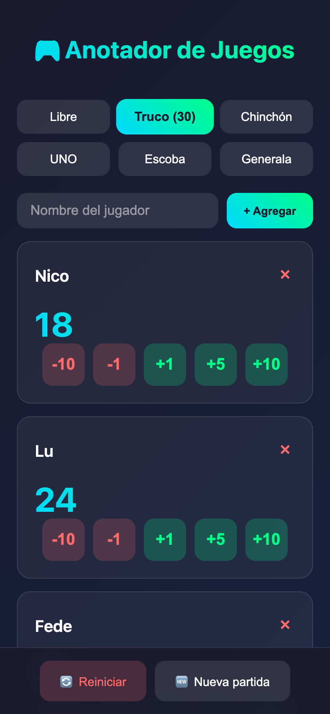

<div align="center">

# 🎴 Anotador de Juegos

**A phone-first scorekeeper for game night: Truco, Chinchón, UNO, Escoba, Generala or any game you like.**

[](https://nico-sanchez.github.io/nico-apps-anotador/)
[](https://github.com/Nico-Sanchez/nico-apps-anotador/actions/workflows/pages/pages-build-deployment)




</div>

## Features

- **Game presets** with a target score; the app announces the first player who reaches it:

  | Preset   | Target |
  | -------- | -----: |
  | Libre    |      — |
  | Truco    |     30 |
  | Chinchón |    100 |
  | UNO      |    500 |
  | Escoba   |     15 |
  | Generala |      — |

- **Any number of players**, each with quick buttons for `-10`, `-1`, `+1`, `+5` and `+10`.
- **Survives a closed tab** — players, scores and the selected game are kept in `localStorage`.
- **Reset or start over** — zero every score, or clear the table for a new match.
- **Works offline** — a service worker caches the app after the first visit.
- **Light and dark** — follows the system colour scheme.

## Install on your phone

Open the [live demo](https://nico-sanchez.github.io/nico-apps-anotador/) and use your browser's **Add to Home Screen** option. It then opens full screen, like a native app.

## Run locally

Service workers need a real origin, so serve the folder instead of opening the file:

```bash
python3 -m http.server 8000
```

Then browse to <http://localhost:8000>.

## Project structure

```text
index.html     UI, styles and game logic
manifest.json  PWA manifest (name, colours, display mode)
sw.js          Cache-first service worker
```

## More apps

Part of a small collection of web apps — see the [apps landing page](https://nico-sanchez.github.io/apps-landing/).
